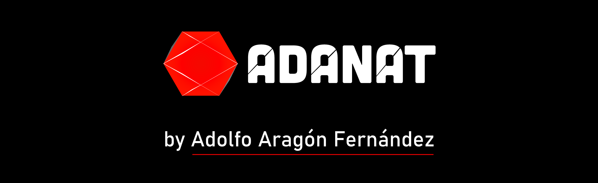

<p align="center">
  
</p>

<h2 align="center">Hola 👋, soy Adolfo Aragón</h2>
<p align="center">
  <b>Desarrollador PHP full stack</b> · Director de <a href="https://autoescuelamiguel.com">Autoescuela Miguel</a>
</p>

<p align="center">
  <a href="https://adanat.com"></a>
  <a href="https://linkedin.com/in/adolfo.aragon"></a>
  <a href="https://x.com/adonet"></a>
</p>

---

```php
<?php

final class Adolfo
{
    public array $codigo = [
        'PHP', 'JavaScript', 'SQL', 'HTML', 'CSS', 'Python',
    ];

    public array $herramientas = [
        'Laravel', 'Filament', 'Tailwind CSS', 'Bootstrap', 'MySQL', 'Git',
    ];

    public array $intereses = [
        'automatización', 'datos abiertos', 'ciberseguridad', 'IA aplicada',
    ];

    public function trabajo(): string
    {
        return 'Aplicaciones web a medida: gestión, estadísticas y automatización.';
    }

    public function web(): string
    {
        return 'https://adanat.com';
    }
}
```

### 🛠️ Con qué trabajo

<p align="left">
  
</p>

### 📈 Actividad

<p align="left">
  
</p>

### 🐍 Mi gráfico de contribuciones, devorado

<picture>
  <source media="(prefers-color-scheme: dark)" srcset="https://raw.githubusercontent.com/adonet/adonet/output/serpiente-oscuro.svg">
  <source media="(prefers-color-scheme: light)" srcset="https://raw.githubusercontent.com/adonet/adonet/output/serpiente.svg">
  
</picture>
